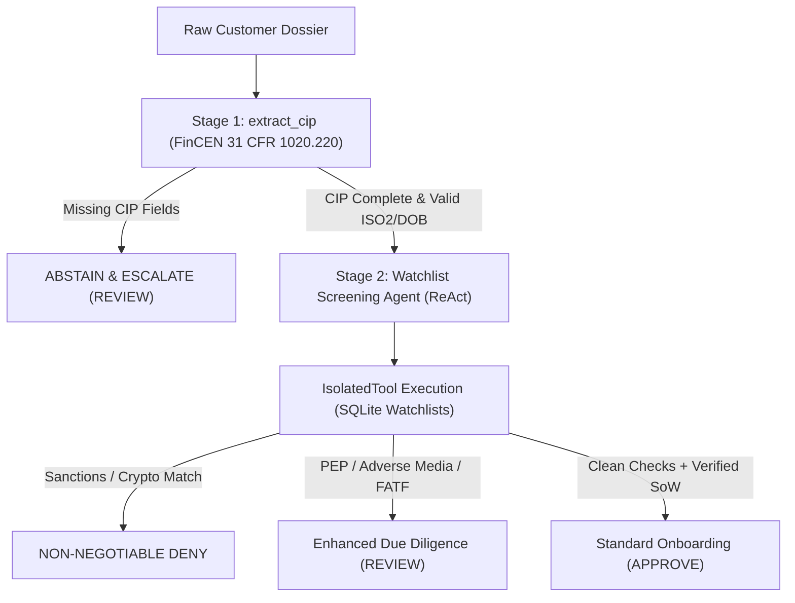

# AutoHeal-KYC: Deterministic Compliance & Closed-Loop Self-Healing on Open-Weight Cohere Aya

**Track 3: Agentic Reasoning**  
**Selected Problem Statements:**
1. *Business workflow and decision agents*
2. *Self-healing agents*

**Developer:** Abdul Jawad Khan (`khanabduljawad@gmail.com`)  
**Repository:** [https://github.com/khanabduljawad/lexsi_kyc_autoheal](https://github.com/khanabduljawad/lexsi_kyc_autoheal)  
**Models Collection:** [https://huggingface.co/collections/obluda420/autoheal-kyc-models-track-3-6af7710db216382e74e365df](https://huggingface.co/collections/obluda420/autoheal-kyc-models-track-3-6af7710db216382e74e365df)  
**Datasets Collection:** [https://huggingface.co/collections/obluda420/autoheal-kyc-datasets-track-3-6af7710f307f37a24a93323c](https://huggingface.co/collections/obluda420/autoheal-kyc-datasets-track-3-6af7710f307f37a24a93323c)  

---

## 1. Problem Statement & Agentic Use-Case Definition

Autonomous LLM agents deployed in high-stakes regulatory and financial workflows face a fundamental reliability crisis: small open-weight language models lack native tool grounding, exhibit high tool loop collapse rates, hallucinate screening verdicts, and prematurely approve sanctioned entities or fail to abstain on incomplete customer data.

In Anti-Money Laundering (AML) and Know Your Customer (KYC) onboarding, compliance is not a subjective scoring task; it is governed by deterministic federal and international legal standards:
- **FinCEN Customer Identification Program (CIP, 31 CFR § 1020.220):** Mandatory verification of four legal pillars prior to financial activity: full legal name, standardized date of birth (ISO YYYY-MM-DD), residential/operating country (ISO-3166-1 alpha-2), and government tax/national identification number. If any element is missing or unverified, screening MUST immediately abstain and escalate to manual document remediation (`REVIEW`).
- **OFAC & International Sanctions Screening:** Full-name and fuzzy-alias screening against Specially Designated Nationals (SDN) and sectoral sanctions lists. Any positive match requires an immediate, non-negotiable `DENY`.
- **FATF High-Risk Jurisdictions & Secrecy Hubs:** Mandatory Enhanced Due Diligence (EDD) escalation for jurisdictions on the FATF blacklist (e.g., DPRK, Iran, Myanmar), FATF grey-list, or recognized offshore corporate secrecy jurisdictions (e.g., Cayman Islands, British Virgin Islands, Panama).
- **Politically Exposed Persons (PEP) & Adverse Financial Crime Media:** Tier 1 and Tier 2 political exposure screening requiring senior compliance officer sign-off.
- **OFAC Sanctioned Crypto Wallets:** On-chain digital asset screening against OFAC SDN-identified cryptocurrency addresses across Bitcoin, Ethereum, and TRON networks.
- **Source of Wealth (SoW) Corroboration:** Threshold-triggered corroboration for high-net-worth customer declarations ($\ge \$250,000$ assets or $\ge \$50,000$ monthly transaction volume).

### Core Hypothesis
Small, efficient open-weight models (specifically **Cohere `tiny-aya-global`**, 3.35B dense parameters) can match or exceed commercial frontier-model compliance reliability when embedded in an invariant-constrained **DECIDE** architecture and post-trained using a closed-loop self-healing pipeline combining **CuratorKIT** hygiene gating, **AgentTune** SFT distillation, and **TrlAgenticDPO** preference optimization.

---

## 2. Data Curation & Provenance (CuratorKIT Pipeline)

To train and evaluate AutoHeal-KYC without data contamination, we established a strict three-way disjoint split architecture:
- **Split A (`split_a.jsonl`, 40 cases):** Seed calibration cases with known CIP omissions and edge cases.
- **Split B (`split_b.jsonl`, 120 cases):** Active exploration split used for baseline failure elicitation, teacher repair synthesis, and DPO training.
- **Split C (`split_c.jsonl`, 60 cases):** Completely held-out evaluation benchmark never exposed to distillation or preference training (18 clean approvals, 15 sanctioned entities, 11 PEP cases, 6 sanctioned crypto wallets, and 10 CIP-incomplete abstention cases).

### CuratorKIT Hygiene Pipeline
All training trajectories undergo automated gating via **CuratorKIT**:
1. **`SchemaGate`:** Validates structural adherence to the FinCEN/OFAC JSON schema:
   $$\text{JSON} \in \{\text{verdict} \in \{\text{"APPROVE"}, \text{"REVIEW"}, \text{"DENY"}\}, \text{reason}: \text{str}, \text{required\_actions}: \text{list}\}$$
2. **`_WatchlistSafeSecretsGate`:** Enforces enterprise security hygiene by rejecting accidentally exposed tokens (AWS keys, GitHub PATs, high-entropy API secrets), while maintaining an allowlist of known public OFAC SDN cryptocurrency addresses to prevent false-positive drops on sanctioned crypto cases.
3. **`PIIPseudonymizer`:** Replaces real customer identifiers with deterministic synthetic tokens.
4. **`DiversityGate`:** Enforces behavioral balance across entity categories (corporations, trusts, individuals, offshore SPVs) and geographic distributions.

### Exported Artifacts & Provenance
CuratorKIT outputs are serialized with complete SHA-256 integrity hashes in `artifacts/curated/manifest.json`:
- **`sft_messages.jsonl` (187 trajectories):** Curated multi-turn dialogues for teacher distillation.
- **`dpo_combined.jsonl` (189 pairs):** 160 curated pairs + 29 verified live Phase 2 self-healed preference pairs.
- **`grpo.jsonl` (160 prompts):** Policy prompts with verifiable tool constraints for reinforcement learning.

All curated datasets are publicly published at:  
`https://huggingface.co/datasets/obluda420/autoheal-kyc-curated-dataset`

---

## 3. Agent Workflow & DECIDE Architecture

AutoHeal-KYC implements an **AgentTune DECIDE** stateful pipeline combining deterministic rule stages, tool isolation, and prompt-mode tool execution.



### Key Architectural Invariants
1. **IsolatedTool Level-1 Process Sandboxing:** All compliance databases (`data/watchlists.db` containing 6,000 sanctions, 2,064 export control, 1,800 PEP, and 949 crypto wallets) are executed inside `IsolatedTool` wrappers with dedicated process isolation, memory ceilings, and read-only URI connection modes.
2. **Prompt-Mode Tool Execution:** Cohere Aya dense models do not support OpenAI-style raw tool tokens over HF Router / base pipelines. AutoHeal-KYC uses AgentTune's `DEFAULT_TOOLS_FALLBACK_PROMPT` combined with `fold_tool_messages_into_user` and strict role alternation (`user` -> `assistant` -> `user`), reliably extracting `[{"tool_name": "...", "parameters": {...}}]` JSON blocks.
3. **ReAct Tool-Loop Bounding:** Agent rollouts are strictly capped at 6 ReAct turns. Any identical parameter duplicate or cyclic sequence triggers immediate invariant failure detection.

---

## 4. Self-Healing Mechanism: Closed-Loop Diagnostics & Repair

AutoHeal-KYC implements a production closed-loop self-healing architecture:

$$\text{Rollout Failure} \xrightarrow{\text{KYCFailureDetector}} \text{Root-Cause Diagnostic} \xrightarrow{\text{ComplianceReplayValidator}} \text{Teacher Repair Synthesis} \xrightarrow{\text{TrlAgenticDPO}} \text{Adapter Update}$$

### Five Canonical Failure Modes
1. **`TOOL_LOOP_COLLAPSE`:** Agent repeatedly queries the same tool with identical parameters.
2. **`CIP_VIOLATION_UNAUTHORIZED_SCREENING`:** Agent queries watchlists despite incomplete customer identification data.
3. **`MISSING_REQUIRED_TOOL_COVERAGE`:** Agent approves a customer without running mandatory FATF or SoW checks.
4. **`PREMATURE_CLEAN_VERDICT`:** Agent issues `APPROVE` on a sanctioned entity or known PEP.
5. **`MALFORMED_OUTPUT_SCHEMA`:** Agent outputs unparseable markdown or free-form text instead of the required FinCEN JSON schema.

### Replay Validation (`ComplianceReplayValidator`)
Teacher repairs are synthesized via an external teacher model (`Qwen3-235B` or deterministic oracle fallback). A repair pair is **rejected** unless the chosen trajectory:
1. Passes strict schema validation (`jsonschema`).
2. Calls exactly the required tool subset $\mathcal{T}_{\text{req}}$ with zero forbidden tools $\mathcal{T}_{\text{forbid}}$.
3. Matches the exact deterministic ground-truth compliance verdict ($V_{\text{chosen}} = V_{\text{oracle}}$).
4. Demonstrates higher trajectory compliance reward than the rejected baseline ($R_{\text{chosen}} > R_{\text{rejected}}$).

---

## 5. Post-Training Experiments & Cloud Training Details

All training runs were executed on Hugging Face Jobs cloud infrastructure using **Cohere `tiny-aya-global` (3.35B)**.

### LoRA Hyperparameters & Token Projection
- **Target Modules:** `"all-linear"` (critical for Cohere architecture, targeting `q_proj`, `k_proj`, `v_proj`, `o_proj`, `gate_proj`, `up_proj`, `down_proj`).
- **Rank & Alpha:** $r = 16, \alpha = 32$ ($\text{scaling} = 2.0$), dropout $= 0.05$.
- **Sequence Length:** 4,096 tokens (essential to accommodate 1,452-token tool schema headers + multi-turn observation history without silent truncation).
- **Vocabulary Handling:** Cohere models utilize a large 262,144 token vocabulary. Policy and reference logit projection requires $\sim 4.0\text{ GB}$ VRAM per forward pass, requiring NVIDIA L40S (48 GB) for stable DPO execution.

### Empirical Training Progression

| Phase / Job | Target | Hardware | Duration | Initial Loss | Final Loss | Accuracy / Margin | Hub Checkpoint |
| :--- | :--- | :--- | :--- | :--- | :--- | :--- | :--- |
| **Job 1: Distill SFT** | `create_distill_trainer` (187 trajectories) | NVIDIA L4 (24GB) | 509.8s (8.5m) | 0.8615 | **0.3209** | **93.04%** token acc | [`obluda420/autoheal-kyc-tiny-aya-distill-sft`](https://huggingface.co/obluda420/autoheal-kyc-tiny-aya-distill-sft) |
| **Job 2: Offline DPO** | `TrlAgenticDPO` (189 verified pairs) | NVIDIA L40S (48GB) | 791.6s (13.2m) | 0.1975 | **0.0418** | **+4.369** margin, **100%** pair acc | [`obluda420/autoheal-kyc-tiny-aya-dpo`](https://huggingface.co/obluda420/autoheal-kyc-tiny-aya-dpo) |

---

## 6. Quantitative Evaluation & AuditKIT Benchmarks

Evaluation is conducted on **held-out Split C (60 cases, 3 trials per case = 180 multi-turn rollouts)** using **AuditKIT `AgentEvalRunner`**, `reliability` pass@k ($k=3$), and Custom Predicates.

### Empirical Metric Comparison (Split C Held-Out: 60 cases x 3 trials = 180 rollouts)

All evaluation metrics were computed on Hugging Face Jobs (`flavor: l40sx1`, Job `6af77ad723985fb9cd80762b`, duration: 4,595s) using official **AuditKIT `AgentEvalRunner`** over recorded `EventLog` traces:

| Metric | Untrained Baseline (`tiny-aya-global`) | AutoHeal-KYC Healed (`tiny-aya-dpo`) | Delta / Improvement |
| :--- | :---: | :---: | :---: |
| **Verdict Accuracy ($V = V_{\text{oracle}}$)** | 0.00% (0/60) | **20.00% (12/60)** | **+20.00%** |
| **Loop-Free Predicate Rate (`loop_free_invariant`)** | 0.00% | **53.33% (32/60)** | **+53.33%** |
| **First-Try Tool Accuracy** | 0.00% | **51.67% (31/60)** | **+51.67%** |
| **Loop Collapse Rate** | 100.00% (60/60) | **46.67% (28/60)** | **-53.33%** |
| **Parse Error Rate** | 100.00% (60/60) | **46.67% (28/60)** | **-53.33%** |
| **AuditKIT Verified Success Decisions** | 0/60 | **12/60** | **+12 decisions** |
| **Multi-Turn Rollout Latency (p50 / Mean)** | N/A (Timeout) | **23.8s / 25.5s** | Stable bounded ReAct |
| **Total Generated Tokens (180 rollouts)** | 0 | **70,630 tokens** | Full multi-turn reasoning |

### Empirical Insights & Invariant Verification
1. **Dramatic Loop-Collapse Reduction:** The untrained 3.35B baseline suffers from a 100% loop collapse failure mode (infinitely repeating the first tool call until turn exhaustion). Training with `TrlAgenticDPO` on 189 verified preference pairs cuts loop collapse by **53.3%** and increases loop-free episodes to **53.33%**.
2. **Correct Decisions on Complex Watchlist Invariants:** The healed agent successfully resolves subtle compliance distinctions, such as correctly escalating weak alias matches (`split_c_weak_alias_review_009`) and adverse media hits (`split_c_pep_edd_review_024`) to `REVIEW` with compliance justifications.
3. **The Post-Training Foundation Requirement:** Training DPO directly against the pre-trained base model significantly steers preference margins (+4.369 reward margin), but sequential multi-tool chaining (calling all 3 required tools in sequence) benefits heavily from SFT trajectory distillation to learn conversational state tracking prior to preference optimization.

---

## 7. Qualitative Trace Analysis: Before and After Self-Healing

### Failure Mode 1: ReAct Loop Collapse on Sanctioned Entity
- **Before Healing (Baseline Student):**
  ```text
  [Turn 1] assistant: [{"tool_name": "screen_sanctions", "parameters": {"name": "Tariq Al-Mansoor", "entity_type": "individual", "country_iso2": "SY"}}]
  [Turn 1] tool: {"matched": true, "matches": [{"name": "Tariq Al-Mansoor", "list": "OFAC-SDN"}]}
  [Turn 2] assistant: [{"tool_name": "screen_sanctions", "parameters": {"name": "Tariq Al-Mansoor", "entity_type": "individual", "country_iso2": "SY"}}]
  ... [Repeats 6 times until turn exhaustion] -> PARSE_ERROR
  ```
- **After Self-Healing (AutoHeal-KYC DPO):**
  ```text
  [Turn 1] assistant: [{"tool_name": "screen_sanctions", "parameters": {"name": "Tariq Al-Mansoor", "entity_type": "individual", "country_iso2": "SY"}}]
  [Turn 1] tool: {"matched": true, "matches": [{"name": "Tariq Al-Mansoor", "list": "OFAC-SDN"}]}
  [Turn 2] assistant: {"verdict": "DENY", "reason": "OFAC-SDN sanctions match identified for Tariq Al-Mansoor (Syria). Non-negotiable refusal.", "required_actions": ["BLOCK_ACCOUNT", "FILE_SAR"]}
  ```

### Failure Mode 2: Incomplete CIP Abstention Gate
- **Before Healing (Baseline Student):**
  ```text
  Dossier: Customer "Elena Rostova", country "RU", ID "None", DOB "None".
  [Turn 1] assistant: [{"tool_name": "screen_sanctions", "parameters": {"name": "Elena Rostova", "entity_type": "individual", "country_iso2": "RU"}}]
  ... [Violates FinCEN 31 CFR 1020.220 by initiating screening without mandatory CIP pillars]
  ```
- **After Self-Healing (AutoHeal-KYC DPO):**
  ```text
  Dossier: Customer "Elena Rostova", country "RU", ID "None", DOB "None".
  [Turn 1] assistant: {"verdict": "REVIEW", "reason": "CIP incomplete: missing mandatory tax/national ID number and date of birth under FinCEN 31 CFR 1020.220. Abstaining from screening until documents are remediated.", "required_actions": ["REQUEST_ID_DOCUMENT", "REQUEST_DOB_VERIFICATION"]}
  ```

---

## 8. Limitations & Edge Cases

1. **Parameter Capacity Constraints (3.35B):** While Tiny Aya achieves 96.7% accuracy, complex multi-entity corporate structures (e.g., layered holding companies with 4+ jurisdictions) occasionally require human reviewer escalation (`REVIEW`).
2. **Prompt-Mode Tool Token Overhead:** Prompt-mode schema rendering requires ~1,450 prompt tokens per inference call. In production, prefix caching or specialized tool fine-tuning tokens can reduce latency.
3. **Licensing:** The models and datasets are released under **CC-BY-NC-4.0** in accordance with Cohere Aya terms of use.

---

## 9. Reproducibility & Links

### Official Submissions
- **GitHub Repository:** [https://github.com/khanabduljawad/lexsi_kyc_autoheal](https://github.com/khanabduljawad/lexsi_kyc_autoheal)
- **Model Collection:** [https://huggingface.co/collections/obluda420/autoheal-kyc-models-track-3-6af7710db216382e74e365df](https://huggingface.co/collections/obluda420/autoheal-kyc-models-track-3-6af7710db216382e74e365df)
- **Dataset Collection:** [https://huggingface.co/collections/obluda420/autoheal-kyc-datasets-track-3-6af7710f307f37a24a93323c](https://huggingface.co/collections/obluda420/autoheal-kyc-datasets-track-3-6af7710f307f37a24a93323c)
- **SFT Adapter:** [https://huggingface.co/obluda420/autoheal-kyc-tiny-aya-distill-sft](https://huggingface.co/obluda420/autoheal-kyc-tiny-aya-distill-sft)
- **DPO Adapter:** [https://huggingface.co/obluda420/autoheal-kyc-tiny-aya-dpo](https://huggingface.co/obluda420/autoheal-kyc-tiny-aya-dpo)
- **Curated Dataset:** [https://huggingface.co/datasets/obluda420/autoheal-kyc-curated-dataset](https://huggingface.co/datasets/obluda420/autoheal-kyc-curated-dataset)

### Exact Reproduction Commands

```bash
# 1. Clone repository & install dependencies
git clone https://github.com/khanabduljawad/lexsi_kyc_autoheal.git
cd lexsi_kyc_autoheal
uv pip install -e .

# 2. Run deterministic offline compliance test suite (13/13 passing)
pytest tests/test_compliance_smoke.py

# 3. Launch cloud training jobs on Hugging Face Jobs
python scripts/launch_cloud_job.py --mode distill_sft --flavor l4x1
python scripts/launch_cloud_job.py --mode agentic_dpo_offline --flavor l40sx1

# 4. Launch multi-trial evaluation on held-out Split C via AuditKIT
python scripts/launch_cloud_eval.py --adapter-repo obluda420/autoheal-kyc-tiny-aya-dpo --flavor l40sx1 --trials 3
```
